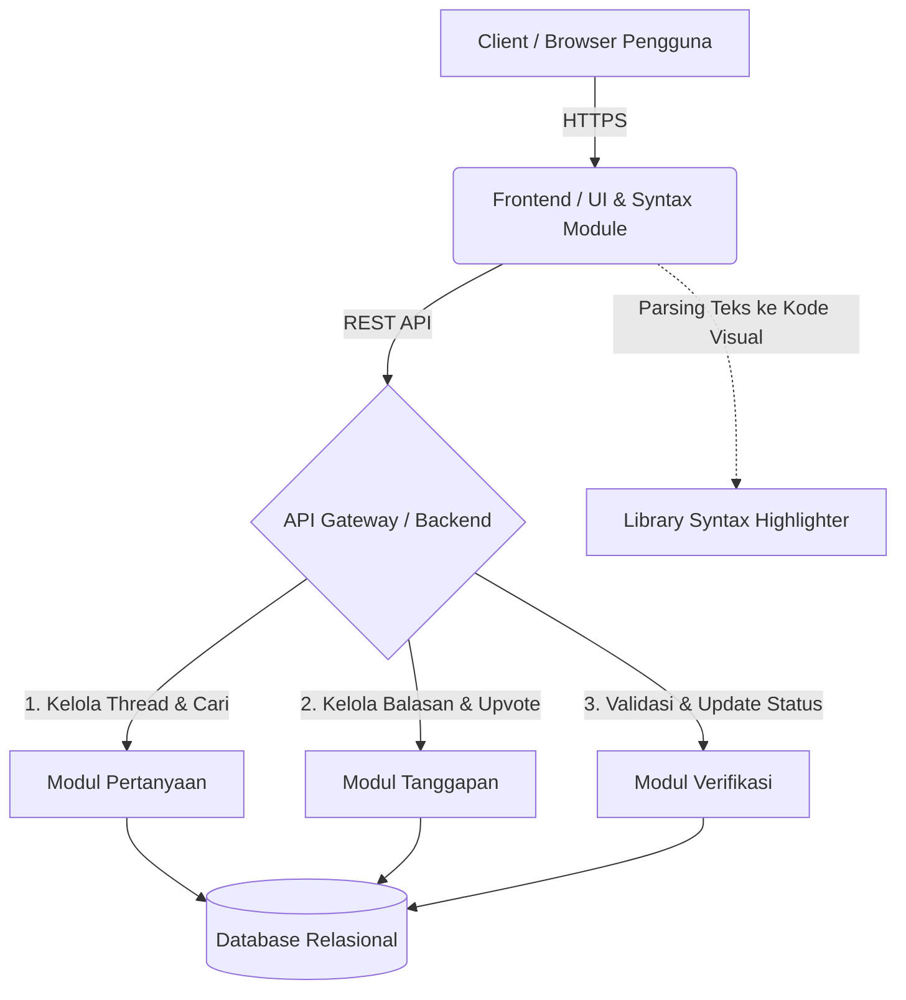

# Dokumen Desain Layanan: Sistem Peer Tutor

**Tim:** Platform Pembelajaran Kolaboratif
**Fokus Fitur Utama:** Forum Tanya-Jawab Koding & Verifikasi Solusi

# 1. Kebutuhan Terpilih dan Asumsi

*Kebutuhan Sistem (Requirements):*

*R1 (Pengajuan Pertanyaan):* Sistem memfasilitasi mahasiswa untuk mengajukan pertanyaan baru yang mencakup judul, kategori/tag bahasa pemrograman, deskripsi kendala, dan cuplikan kode.
*R2 (Tanggapan Tutor):* Sistem memungkinkan peer tutor untuk memberikan solusi atau balasan dengan dukungan penyorotan sintaks kode (*syntax highlighting*) secara otomatis.
*R3 (Verifikasi Solusi):* Sistem menyediakan fitur bagi penanya untuk mengevaluasi dan menandai salah satu tanggapan tutor sebagai "Solusi Terverifikasi", yang akan mengubah status *thread* menjadi selesai (*solved*).
*R4 (Pencarian & Filter):* Sistem memiliki kapabilitas pencarian berdasarkan kata kunci pada judul dan pemfilteran berbasis tag bahasa pemrograman (misal: Python, JavaScript, Java).

**Asumsi Tim:**

* Pengguna (Mahasiswa sebagai penanya dan Peer Tutor sebagai penjawab) sudah terdaftar dalam sistem, memiliki akun yang valid, dan masuk (login) ke dalam platform.
* Infrastruktur basis data relasional memadai untuk menangani relasi kompleks antara entitas *User*, *Question*, *Answer*, dan *Tags*.

## 2. Daftar Modul Beserta Tanggung Jawab

| Nama Modul | Tanggung Jawab |
| --- | --- |
| **Modul Pertanyaan (Question Module)** | Mengelola *Create, Read, Update, Delete* (CRUD) pertanyaan, menetapkan tag kategori, menampilkan daftar *thread*, dan memproses kueri pencarian serta filter. |
| **Modul Tanggapan (Answer Module)** | Menyimpan data jawaban dari peer tutor, mengelola sistem reputasi/penilaian (*upvote*), dan melacak atribusi kepemilikan pembuat jawaban. |
| **Modul Verifikasi (Verification Module)** | Mengontrol *state management* status pertanyaan (dari *Open/Answered* menjadi *Solved*) dan memvalidasi hak akses bahwa hanya pembuat pertanyaan yang dapat melakukan verifikasi. |
| **Modul Tampilan & Highlighter (UI & Code Syntax)** | Me-*render* antarmuka pengguna, menyediakan opsi tema visual (*Dark/Light mode*), dan mem-parsing blok kode dengan *syntax highlighting* agar mudah dibaca. |

## 3. Diagram Arsitektur dan Label Hubungan

**Label Hubungan:**

* **Client ke Frontend:** Pengguna berinteraksi dengan antarmuka untuk mengetik pertanyaan, membaca solusi, atau menekan tombol verifikasi. *Syntax Highlighter* bekerja di sisi klien (frontend) untuk mewarnai kode secara *real-time*.
* **Frontend ke Backend:** Meneruskan instruksi pengguna (menyimpan pertanyaan, memposting jawaban, mengubah status *thread*) melalui *endpoint* API.
* **Backend ke Database:** Menyimpan relasi data secara persisten. Tabel dirancang saling terkait (Pertanyaan memiliki banyak Jawaban, Jawaban dimiliki oleh Tutor).

## 4. Alur Satu Fitur (Verifikasi Solusi)

**Skenario Berhasil (Tanggapan Diterima):**

1. Penanya membuka halaman detail *thread* pertanyaan yang telah ia buat.
2. Penanya menelusuri daftar tanggapan atau solusi yang telah dikirimkan oleh para *peer tutor*.
3. Penanya mengevaluasi apakah ada tanggapan yang tepat dan berhasil menyelesaikan masalah kodenya.
4. Penanya menemukan jawaban yang paling akurat, lalu menekan tombol "Tandai Solusi" pada jawaban tersebut.
5. Modul Verifikasi pada sistem memproses permintaan dan memperbarui status pertanyaan di database menjadi 'Solusi Terverifikasi' (*Solved*).
6. Tampilan antarmuka (*UI Module*) langsung diperbarui, mengubah desain kartu jawaban tersebut dengan menambahkan indikator visual "Solusi Terverifikasi" (misal: bingkai hijau atau ikon centang).

**Skenario Alternatif (Tanggapan Belum Tepat):**

* Pada langkah ke-3, jika penanya merasa tanggapan tutor belum menyelesaikan masalah (atau *error* masih terjadi), penanya memilih untuk tidak menekan tombol verifikasi.
* Penanya dapat menunggu tanggapan dari tutor lain, atau mengirimkan balasan komentar baru pada *thread* tersebut untuk meminta kejelasan lebih lanjut (misal: menyertakan *log error* tambahan).

## 5. Dua Keputusan Desain dan Alasannya

1. **Keputusan:** Hanya pembuat pertanyaan (penanya) yang memiliki otoritas untuk menekan tombol "Tandai Solusi", bukan moderator atau tutor itu sendiri.
* **Alasan:** Memastikan tingkat akurasi verifikasi. Sebuah solusi koding mungkin terlihat benar secara teoritis bagi orang lain, tetapi konteks lingkungan atau versi *software* penanya mungkin berbeda. Hanya penanya yang tahu pasti apakah kode tersebut benar-benar menyelesaikan kendala spesifik yang ia hadapi di perangkatnya.

2. **Keputusan:** Implementasi *Syntax Highlighting* dilakukan secara otomatis oleh sistem, tanpa mengharuskan tutor memformat HTML/CSS secara manual.
* **Alasan:** Mengurangi beban kognitif bagi *peer tutor* sehingga mereka dapat fokus pada pemecahan masalah logika, bukan pada penataan tampilan. Secara bersamaan, ini sangat meningkatkan keterbacaan kode (*readability*) bagi penanya saat mempelajari solusi.
